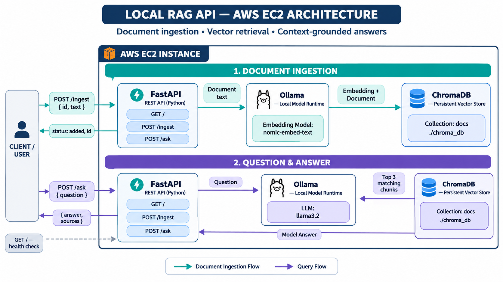
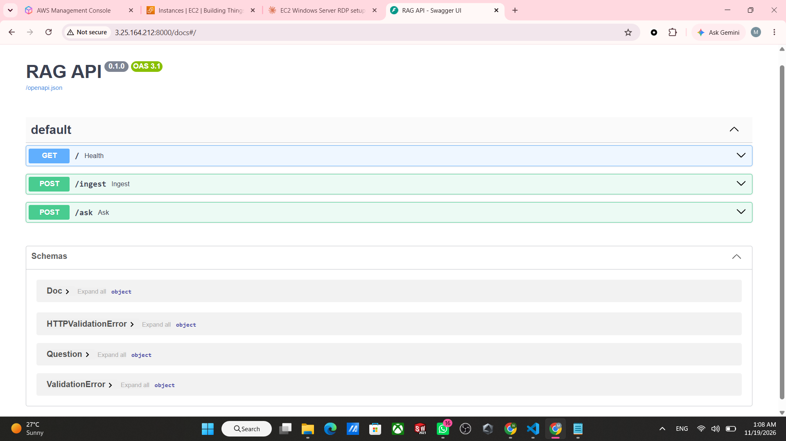
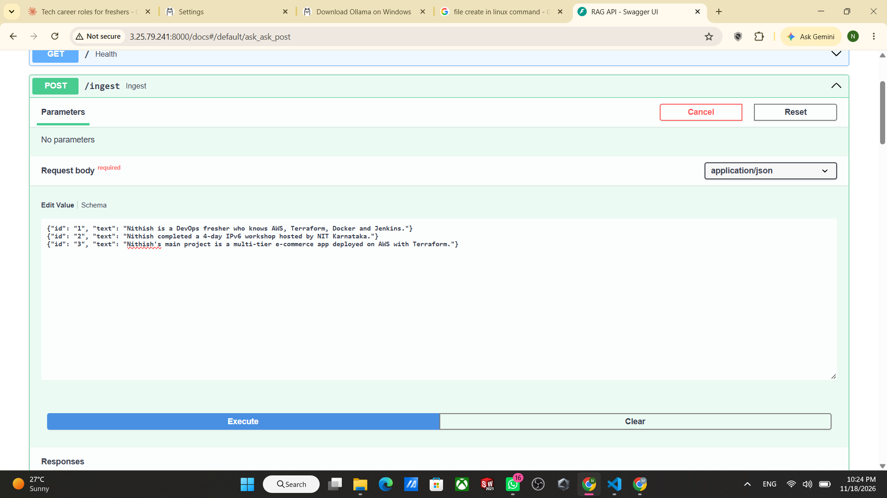
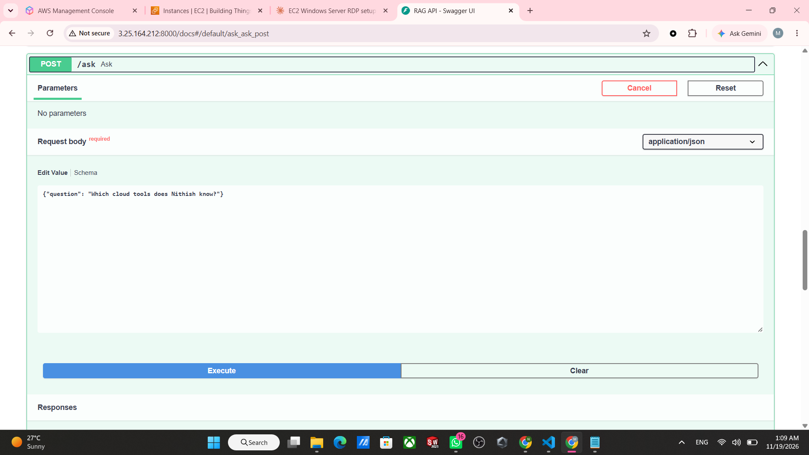

# Local RAG API on AWS EC2

A Retrieval-Augmented Generation (RAG) API that runs fully on a single AWS EC2 instance.
You ingest your own documents, then ask questions and get answers grounded in those documents, with the sources shown.

## Architecture



## How It Works

### 1. Document ingestion (`POST /ingest`)
1. The client sends a document as `{ "id", "text" }` to the FastAPI server.
2. FastAPI sends the text to **Ollama**, which turns it into a vector using the `nomic-embed-text` embedding model.
3. The embedding and the original document are stored in **ChromaDB** (collection `docs`, saved in `./chroma_db`).
4. The API replies with `{ "status": "added", "id": ... }`.

### 2. Question and answer (`POST /ask`)
1. The client sends `{ "question": ... }`.
2. The question is embedded and ChromaDB returns the top matching document chunks.
3. The question and the matching chunks go to the **llama3.2** model running in Ollama.
4. The API returns `{ "answer", "sources" }`, so you can see which documents the answer came from.

### Health check (`GET /`)
Returns a simple status so you can confirm the API is running.

## Tech Stack

| Component | Purpose |
|-----------|---------|
| AWS EC2 (Amazon Linux 2023) | Hosts everything |
| FastAPI + Uvicorn | REST API |
| Ollama | Runs models locally |
| nomic-embed-text | Embedding model |
| llama3.2 | Language model for answers |
| ChromaDB | Persistent vector database |
| Python 3.9 | Language |

## API Demo

### Swagger UI


### Ingest a document


### Ask a question
The answer comes with the sources that were retrieved.



## Setup

```bash
git clone https://github.com/YOUR-USERNAME/rag-api.git
cd rag-api
python3 -m venv venv
source venv/bin/activate
pip install -r requirements.txt
```

Install Ollama and pull the models:

```bash
curl -fsSL https://ollama.com/install.sh | sh
ollama pull nomic-embed-text
ollama pull llama3.2
```

## Run

```bash
uvicorn main:app --host 0.0.0.0 --port 8000
```

Open `http://<EC2-PUBLIC-IP>:8000/docs` for the Swagger UI.

## Example Requests

```bash
curl -X POST http://<EC2-PUBLIC-IP>:8000/ingest \
  -H "Content-Type: application/json" \
  -d '{"id": "1", "text": "Nithish is a DevOps fresher who knows AWS, Terraform, Docker and Jenkins."}'

curl -X POST http://<EC2-PUBLIC-IP>:8000/ask \
  -H "Content-Type: application/json" \
  -d '{"question": "Which cloud tools does Nithish know?"}'
```

## Project Structure

```
rag-api/
├── main.py
├── requirements.txt
├── chroma_db/        (ignored by git)
├── docs/images/
│   ├── architecture.png
│   ├── swagger-home.png
│   ├── ingest-response.png
│   └── ask-response.png
├── .gitignore
└── README.md
```

## Author

Nithish - [GitHub](https://github.com/Nithish-delsm)
