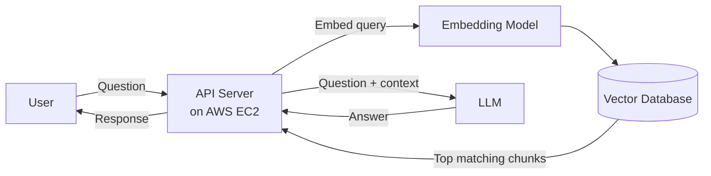

# RAG API

A Retrieval-Augmented Generation (RAG) API deployed on AWS EC2.
It answers questions using your own documents plus an LLM.

## Architecture



GitHub draws this diagram automatically.

## Features

- Ask questions over your documents
- REST API endpoints
- Runs on AWS EC2 (Amazon Linux 2023)

## Tech Stack

- Python 3.9
- AWS EC2
- (add your libraries: FastAPI / Flask, etc.)

## Setup

```bash
git clone https://github.com/YOUR-USERNAME/rag-api.git
cd rag-api
python3 -m venv venv
source venv/bin/activate
pip install -r requirements.txt
```

## Run

```bash
python app.py
```

## Project Structure

```
rag-api/
├── app.py
├── requirements.txt
├── .gitignore
└── README.md
```

## Author

Your Name - [GitHub](https://github.com/Nithish-delsm)
